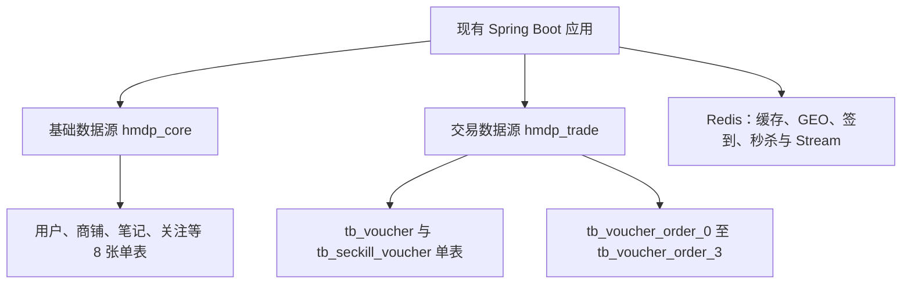

# hmdp 分库分表设计：当前项目可落地版本

> 目标已于 2026-10-18 更新：用户明确这是学习项目，要求覆盖较完整的分片、查询与一致性设计。当前主方案见同目录 `database-sharding-learning-plan.md`。本文保留为最小改动方案及原始数据库调研记录，不再以当前数据量小作为限制学习架构的理由。

调研日期：2026-10-18（Asia/Shanghai）。范围：本机 `127.0.0.1:3306/hmdp` 的只读检查、项目 SQL、Controller、Service、Mapper 和 Redis Lua 脚本。用户目标：当前项目落地，控制复杂度。

## 1. 设计结论

当前数据库总计 1,045 行，没有容量证据支持立即水平分库。优先补齐索引与唯一约束、明确异步订单状态，再进行可回滚的分表演练。

建议的目标结构是：**基础库与交易库按业务垂直分库；仅订单表按 `user_id` 分成 4 张物理表；优惠券、库存与所有订单分表共用同一个交易数据源，保留本地事务。**

“4 张表”是方便当前项目开发和验证的初始规模，并非基于线上容量测算的最优值。先在现有 `hmdp` 库完成 1 库 4 表验证，再根据隔离需求将交易域整体迁出。当前不拆微服务，不引入 XA/Seata，不把 11 张表全部分片。



交易数据源中的库存更新和订单写入必须加入同一个数据库事务。两个 schema 即使部署在同一个 MySQL 实例，也仅实现逻辑隔离，不会增加 CPU、磁盘 I/O 或机器容量；需要资源隔离时再将基础库、交易库部署到不同实例。

## 2. 当前数据库的实际情况

服务器版本为 MySQL 8.4.8，11 张表均为 InnoDB。下表是本次 `COUNT(*)` 读取结果；不是旧初始化 SQL 中的样例数量，也不是 `information_schema.TABLES.TABLE_ROWS` 的估算值。

| 表 | 实际行数 | 主键 | 现有非主键索引 | 当前决定 |
|---|---:|---|---|---|
| `tb_user` | 1,007 | `id`，自增 | `UNIQUE uniqe_key_phone(phone)` | 基础库单表 |
| `tb_user_info` | 0 | `user_id` | 无 | 基础库单表 |
| `tb_shop` | 14 | `id`，自增 | `foreign_key_type(type_id)` | 基础库单表 |
| `tb_shop_type` | 10 | `id`，自增 | 无 | 基础库单表，Redis 缓存 |
| `tb_blog` | 7 | `id`，自增 | 无 | 基础库单表，补查询索引 |
| `tb_blog_comments` | 0 | `id`，自增 | 无 | 基础库单表；评论接口尚未实现 |
| `tb_follow` | 3 | `id`，自增 | 无 | 基础库单表，补正反向索引 |
| `tb_sign` | 0 | `id`，自增 | 无 | 保留单表；当前签到使用 Redis Bitmap |
| `tb_voucher` | 2 | `id`，自增 | 无 | 交易库单表 |
| `tb_seckill_voucher` | 1 | `voucher_id` | 无 | 交易库单表，与订单同库 |
| `tb_voucher_order` | 1 | `id`，应用生成 | 无 | 首个分表对象，按 `user_id` 路由 |

采样时 `tb_follow(user_id, follow_user_id)` 和 `tb_voucher_order(user_id, voucher_id)` 均无重复组合。创建唯一约束前仍需重新检查，因为数据库可能继续写入。

主要关联关系：

- `tb_user.id → tb_user_info.user_id`：用户和扩展信息。
- `tb_user.id → tb_blog.user_id / tb_follow.user_id / tb_follow.follow_user_id`：作者和关注关系。
- `tb_blog.id → tb_blog_comments.blog_id`：笔记与评论。
- `tb_shop_type.id → tb_shop.type_id`：商铺分类。
- `tb_shop.id → tb_voucher.shop_id`：店铺优惠券。
- `tb_voucher.id → tb_seckill_voucher.voucher_id / tb_voucher_order.voucher_id`：券、库存与订单。

这些业务关联并不意味着都必须做数据库 JOIN。当前明确的自定义 JOIN 是优惠券与秒杀库存，位于 `VoucherMapper.xml`。

已读取的 Performance Schema SQL 汇总主要是少量查看表数据和本次诊断语句，无法代表业务峰值；本次没有进行压测，也没有测得任何分片后的性能提升。

## 3. 从现有代码得到的查询需求

以下“已实现”均来自当前代码；个人订单列表、支付回调、评论分页等仅作为后续需求讨论。

| 业务 | 当前查询或写入 | 定位 | 对分片的影响 |
|---|---|---|---|
| 手机号登录 | `WHERE phone = ?`，查不到则创建用户 | `UserServiceImpl.login` | 按用户 ID 分片会让登录缺少分片键，还会破坏手机号的全局唯一性 |
| 用户资料、作者头像 | `WHERE id = ?` / `user_id = ?`；按多个用户 ID 查 | `UserController`、`BlogServiceImpl`、`FollowServiceImpl` | 当前单表主键查询足够；先合并逐条查作者的 N+1 请求 |
| 商铺详情、更新 | 主键查询、更新、缓存失效 | `ShopServiceImpl` | 单表和缓存能满足当前路径 |
| 分类商铺列表 | `WHERE type_id = ?` 分页 | `ShopServiceImpl.queryShopByType` | 已有分类索引；需明确排序，避免无序分页 |
| 附近商铺 | Redis GEO 获取 ID，再 `id IN (...) ORDER BY FIELD(...)` | 同上 | 无须把经纬度或低基数分类作为数据库分片键 |
| 名称搜索 | MyBatis-Plus `.like(name)`，对应包含匹配 | `ShopController.queryShopByName` | 普通 B-tree 索引不能把 `%关键词%` 变成高效范围定位；当前小表可保留，增长后再评估搜索方案 |
| 店铺优惠券 | `v.shop_id = ? AND v.status = 1`，JOIN 库存 | `VoucherMapper.xml` | 券和库存保持同一库、补 `(shop_id,status)` 索引 |
| 发布秒杀券 | 保存券、保存库存，事务中还写 Redis | `VoucherServiceImpl.addSeckillVoucher` | 两张 MySQL 表要同数据源；Redis 写入不属于 MySQL 本地事务 |
| 秒杀入口 | Lua 扣 Redis 预留库存、记录购买用户、XADD | `secKillVoucher`、`seckill.lua` | 此时只是异步受理；请求成功不代表数据库已落单 |
| 消费消息落单 | `user_id + voucher_id` 查重，按券扣数据库库存，插入订单 | `createVoucherOrder` | 查重、插入都带用户 ID；库存和订单必须保持同库事务 |
| 我的/指定作者笔记 | `WHERE user_id = ?` 分页，当前无显式排序 | `BlogController` | 作者查询适合索引；单独按作者分表会影响按笔记 ID 的读取路径 |
| 热门笔记 | `ORDER BY liked DESC` 分页 | `BlogServiceImpl.queryHotBlog` | 全局排序，盲目分表会变成多分片归并 |
| 笔记详情、点赞 | 按笔记 ID 读取、更新点赞数 | `BlogServiceImpl` | 与按作者路由存在冲突，当前不拆笔记表 |
| 关注动态 | Redis ZSET 获取笔记 ID，再批量回表 | `queryFollowBlog` | Feed 中只有笔记 ID，按作者分表后需要额外路由信息 |
| 关注/取关/判断 | `WHERE user_id = ? AND follow_user_id = ?` | `FollowServiceImpl` | 需要唯一约束和正向索引 |
| 发布笔记推送粉丝 | `WHERE follow_user_id = ?` | `BlogServiceImpl.saveBlog` | 需要反向索引；按关注者分片会使此查询广播 |
| 共同关注、签到 | Redis SET 交集、Bitmap | `FollowServiceImpl`、`UserServiceImpl` | 当前没有必要为这两条路径新增数据库分片 |

`VoucherOrderController` 当前仅提供秒杀创建接口，没有个人订单列表、订单详情、支付、取消、核销接口。下面的相关索引和接口约束必须在新增这些能力时落实，不把它们当成现有工作负载。

## 4. 分片之前应做的数据库优化

建议 SQL 位于 `docs/sql/phase-0-indexes.proposed.sql`，**仅生成供评审，未在数据库执行**。

| 表 | 建议索引 | 原因 |
|---|---|---|
| `tb_voucher_order` | `UNIQUE(user_id, voucher_id)` | 同时支持现有查重条件和数据库“一人一券一单”约束 |
| `tb_follow` | `UNIQUE(user_id, follow_user_id)` | 防止重复关注，支持关注判断与取关 |
| `tb_follow` | `(follow_user_id, user_id)` | 发布笔记时按作者查粉丝 |
| `tb_voucher` | `(shop_id, status)` | 与当前店铺上架券查询条件一致 |
| `tb_blog` | `(user_id, create_time DESC, id DESC)` | 支持作者列表；查询同步补充时间和 ID 排序 |
| `tb_blog` | `(liked DESC, id DESC)` | 支持现有热门排序；补充 ID 稳定排序，点赞更新会增加该索引的维护成本 |

不要重复添加 `tb_user.phone` 唯一索引。`tb_shop` 已有 `type_id` 索引，InnoDB 的非唯一二级索引包含主键，无须仅为 `(type_id,id)` 再机械创建一个重复索引；先通过真实 SQL 的执行计划验证。依据：[InnoDB 二级索引](https://dev.mysql.com/doc/refman/8.4/en/innodb-index-types.html)。

联合索引需要匹配左前缀，`(user_id,follow_user_id)` 无法替代按 `follow_user_id` 查询所需的反向索引。参见 [MySQL 联合索引文档](https://dev.mysql.com/doc/refman/8.4/en/multiple-column-indexes.html)。

商铺名称的包含匹配与前缀匹配应区别评估；普通索引不能为以通配符开头的 LIKE 条件提供相同的范围定位能力。参见 [MySQL 范围优化文档](https://dev.mysql.com/doc/refman/8.4/en/range-optimization.html)。

唯一订单约束遵循当前“一人只能购买一单”规则。若未来允许取消后重买、多次购买普通券或同一券有多个活动批次，应先引入清晰的活动/购买资格模型，再调整唯一键；不要直接删除约束。

目前不要给未实现的评论、支付回调、月度归档等功能批量添加索引。减少无效索引也能减少秒杀写入成本。

## 5. 订单分表与交易库设计

### 5.1 物理结构与路由

```text
hmdp_core
  tb_user / tb_user_info
  tb_shop / tb_shop_type
  tb_blog / tb_blog_comments
  tb_follow / tb_sign

hmdp_trade                         # 一个真实交易数据源
  tb_voucher                      # 单表
  tb_seckill_voucher               # 单表
  tb_voucher_order_0
  tb_voucher_order_1
  tb_voucher_order_2
  tb_voucher_order_3
```

```text
逻辑表：tb_voucher_order
分片键：user_id（正整数，创建订单后禁止变更）
物理表后缀：user_id % 4
数据库：始终 hmdp_trade

用户 1001 → tb_voucher_order_1
用户 1002 → tb_voucher_order_2
用户 1004 → tb_voucher_order_0
```

为什么选择用户 ID：现有查重和插入都有它；同一用户的订单集中，后续“我的订单”无需跨分片；唯一键包含分片键，因此同一用户、同一券的重复记录必定竞争同一物理表上的唯一约束。

为什么不按 `voucher_id`：同一热门券的所有订单会集中写入一张表；后续用户订单列表还要跨表查询。为什么不按 `order_id`：现有“一人一券”查重只有用户与券，不能定位物理表，且全局唯一的订单号不等于同一用户同一券只有一条订单。为什么不按月份：近期写入集中，一人一券的唯一性还会被月份边界割裂。

订单分表可以缩小单表及索引、分散订单写入位置，但**不会消除同一张券的数据库库存行锁，也不会增加同一个 MySQL 实例的硬件吞吐**。

### 5.2 当前请求如何路由

| 查询或操作 | 路由策略 |
|---|---|
| 创建订单，含 `user_id` | 精确写一张订单表 |
| 一人一券查重，含 `user_id + voucher_id` | 精确查一张订单表，并由唯一键兜底 |
| 数据库扣库存，含 `voucher_id` | 更新同一交易数据源中的库存单表 |
| 店铺优惠券列表 | 交易库中的券与库存单表 JOIN |
| 将来的“我的订单” | 登录用户 ID 作为分片键，单表游标分页 |
| 将来的订单详情/取消/支付 | 携带可信用户 ID，并使用 `WHERE user_id=? AND id=?` |
| 只有订单 ID 的第三方回调 | 增加持久化路由索引或设计含路由信息的新 ID；不能依赖可过期缓存 |
| 按券统计全部订单 | 不作为在线交易热路径；小规模可限流归并 4 表，大规模用异步聚合读模型 |

当前的 `RedisIdWorker` 是时间戳加计数器，不包含用户或分片信息，不能从旧订单号还原 `user_id % 4`。保留当前 ID 生成方式用于演练可以减少改动，但要维持跨分表唯一性并检查 Redis 持久化、故障切换、时钟和序列溢出边界；当前方案不把 ID 生成器改造列为自动完成的事项。

未来若引入 `tb_order_route(order_id PRIMARY KEY, user_id)`，与订单在同一交易事务中写入；缓存只作加速。回调先查目录得到用户，再路由订单。新增这张目录表也意味着多一次写入，当前没有回调接口，不提前引入。

### 5.3 索引与分页

每张订单物理表保留全部现有字段，并配置：

```sql
PRIMARY KEY (id),
UNIQUE KEY uk_order_user_voucher (user_id, voucher_id)
```

只有在新增个人订单列表时，再添加：

```sql
KEY idx_order_user_created (user_id, create_time DESC, id DESC)
```

对分页使用稳定排序及游标，例如：

```sql
SELECT id, voucher_id, status, create_time
FROM tb_voucher_order
WHERE user_id = :loginUserId
  AND (create_time < :cursorTime
       OR (create_time = :cursorTime AND id < :cursorId))
ORDER BY create_time DESC, id DESC
LIMIT :pageSize;
```

首屏不带游标条件。该 SQL 是新增接口的设计示例，并非当前已经存在的 Mapper。是否再建立 `(user_id,status,create_time,id)` 取决于是否确实需要按状态筛选及执行计划，不默认同时建立两套。

### 5.4 数据访问层与事务

建议通过 ShardingSphere-JDBC 的逻辑表路由管理订单分表；保留业务 SQL 中的逻辑表名，避免 Controller/Service 拼接物理表名。未分片的券、库存必须显式注册为交易数据源的单表，不作为广播表。

先验证当前 JDK 21、Spring Boot 4.1.1、MyBatis-Plus 3.5.17 与拟选中间件版本的兼容性，再锁定依赖和 YAML 格式。本次没有安装中间件，也没有验证任何特定版本的兼容性，不能直接套用旧版 Spring Boot starter 配置。

垂直分库时需建立明确的两组数据访问对象：

| 组成 | 基础域 | 交易域 |
|---|---|---|
| DataSource | `coreDataSource` | `tradeDataSource`，对外为 ShardingSphere 数据源 |
| SqlSessionFactory | `coreSqlSessionFactory` | `tradeSqlSessionFactory` |
| TransactionManager | `coreTransactionManager` | `tradeTransactionManager` |
| Mapper 范围 | 用户、商铺、笔记、关注等 | Voucher、SeckillVoucher、VoucherOrder |

当前 Mapper 都在 `com.hmdp.mapper`，落地时需分包或通过显式绑定区分，不能让两个 `@MapperScan` 重复扫描全部 Mapper。

`createVoucherOrder` 和 `addSeckillVoucher` 使用交易事务管理器，`ShopServiceImpl.update` 使用基础事务管理器。现有通过 Spring 代理调用订单事务的方法应保留。仅仅在同一台 MySQL 上配置两个独立数据源，不能保证它们自动共用一个本地事务连接。

若将库存保留在一个库，而订单按用户分到多个物理库，普通本地事务不再保证二者原子性。ShardingSphere 的 LOCAL 事务也不提供跨数据库节点的一致性保证，参见 [事务文档](https://shardingsphere.apache.org/document/current/en/features/transaction/)。这也是当前只做订单同库分表的核心原因。

## 6. 秒杀正确性需要同步收口

### 6.1 数据库事务和唯一约束

一次落单事务应完成“数据库条件扣库存 + 插入订单”；任何插入失败必须使扣库存回滚。预查询只能是辅助判断，最终依靠唯一键抵御消息重复和并发。

如果先扣库存再插入遇到唯一键冲突，应让异常穿过事务边界触发回滚，然后在事务外查询确认既有订单；不能在事务内吞异常后提交库存扣减。若唯一冲突对应同一用户和券但不同订单号，应返回/记录已存在的真实订单号，避免把新生成但未落库的订单号误报成功。

所有订单写入、重放和迁移应遵循同一用户路由；否则各物理表独立的唯一约束不能提供跨表保护。

### 6.2 明确受理、落单和失败

当前 `secKillVoucher` 在 Lua 执行成功后立即返回订单号。应将此解释为“已受理”，通过结果状态或后续查询让客户端知道最终是否落库。

当前 `createVoucherOrder` 遇到数据库库存不足会直接 `return`；外层 `handlerVoucherOrder` 仍返回 `true`，随后 ACK Stream 消息。这会把“未落库的业务失败”当成已处理，而 Redis 已经扣过预留库存。

建议明确返回 `CREATED / ALREADY_CREATED / REJECTED` 等结果：成功或确认重复后 ACK；临时失败保留重试；永久失败需要持久记录失败/补偿任务后再结束消费。补偿按订单/预留记录幂等，不能每重试一次就给 Redis 库存加一。

当前每个线程只读自己的 Pending；消费者改名或实例故障后，其他消费者的旧 Pending 需要接管机制，例如按空闲时间认领，配合重试次数、失败队列与人工排查入口。不要让某条失败消息无限循环阻塞后续消息。

### 6.3 数据库与 Redis 的边界

发布秒杀券时，MySQL 事务中调用 Redis 不会使 Redis 参与回滚。当前项目可采用“提交后初始化 Redis + 失败状态可重试”的流程；需要可靠投递时，使用同库 outbox 记录任务并由后台重试。活动只在库存初始化完成后开放，并由数据库保留活动与库存事实。

库存不变量需区分预留中、已落单、释放/取消，不能在有待消费消息时直接要求 Redis 剩余库存等于 MySQL 剩余库存。活动收敛后核对两边库存、已提交订单和补偿记录。

本轮 MySQL 分表不要求切换 Redis Cluster。若以后切换，当前 `Collections.emptyList()` 加 Lua 内动态拼 key 的方式需要改造：访问的 key 显式通过 `KEYS` 传入，并让同一次 Lua 的库存、购买集合、Stream 位于同一 hash slot。可按活动使用 `seckill:{voucherId}:stock / buyers / stream`，相应增加多 Stream 消费管理；这仍不能分散单个热门券。共同关注的两个 SET 交集也需单独处理跨 slot 约束。依据：[Lua key 约定](https://redis.io/docs/latest/develop/programmability/eval-intro/)、[Redis Cluster hash tag](https://redis.io/docs/latest/operate/oss_and_stack/reference/cluster-spec/)。

## 7. 其他表暂不分片的理由及未来边界

| 数据域 | 现在怎么处理 | 真正增长后再做什么 |
|---|---|---|
| 用户 | 手机号唯一索引 + ID 主键；避免拆散登录路径 | 用户主体与详情按用户 ID 同路由；手机号到用户 ID 的持久化唯一目录先行，明确注册失败恢复 |
| 商铺 | 单表 + 分类索引 + GEO + 详情缓存 | 先测搜索/缓存瓶颈；若按城市拆分，必须补规范的 `city_id`，并解决只按店铺 ID 访问时的路由 |
| 商铺类型 | 10 行，单表缓存 | 只有确有分片 JOIN 需求时才考虑广播表，否则复制到所有库没有收益 |
| 笔记 | 作者和热度索引，批量查作者，保留单表 | 可考虑主表按笔记 ID、作者列表另建读模型；热门榜用可重建的排序读模型，避免全库 Top-N |
| 评论 | 接口尚未实现，不预设访问成本 | 实现后一般按 `blog_id` 聚合评论与回复，并要求详情/回复接口携带该键；热门笔记仍可能形成热点 |
| 关注 | 唯一正向索引 + 反向粉丝索引 | 按关注者路由正向表时，需要按被关注者组织的粉丝读模型；通过事件同步并接受可控延迟 |
| 签到 | 当前 Redis Bitmap，数据库表未被使用 | 确有持久审计需求时再按用户组织存储；时间作为保留/归档维度 |

避免在没有路由字段的现有接口上强行分片。中间件无法凭空获得未提供的分片键；缺少分片键会导致全路由。绑定表也要求一致的分片规则和适当的关联键，并不自动消除任意跨库 JOIN。参见 [ShardingSphere 分片概念](https://shardingsphere.apache.org/document/current/en/features/sharding/concept/)。

## 8. 迁移顺序与回滚

当前数据量允许维护窗口迁移，优先采用它，避免直接引入双写、CDC 和复杂切换协议。

1. **基线与索引**：保存结构和数据备份；重新检查重复数据；评审并执行索引脚本；对真实查询做 `EXPLAIN` 和代表性数据压测。先修复订单消费确认语义。
2. **同库分表演练**：在独立测试环境配置 4 张订单表和路由，库存和券保持同一底层数据源。验证事务回滚、重复消息和一人一券约束后，才安排正式切换。
3. **停写并排空消息**：关闭秒杀入口及其他相关写入口，等待消费者完成已受理订单、处理 Pending 与补偿；随后暂停消费者并确认没有其他写入者。否则数据库停写期间 Redis 还可能继续接单。
4. **一致性导出及导入**：将订单按 `MOD(user_id,4)` 导入 4 张表；保留订单 ID、状态、时间等全部字段。迁移垂直库时，券、库存和订单一起迁出，其他 8 张表一起迁入基础库或先保留原库。
5. **核对**：原订单行数等于 4 表行数之和；每条记录位于正确后缀；主键不重复，用户/券组合不重复；逐字段比对；按券核对订单、库存和预留状态。仅比行数不够。
6. **切换应用配置**：切换数据源、Mapper 与事务管理器；所有应用实例使用相同路由版本；确保旧表没有旧进程继续写。逐步恢复消费者和入口。
7. **观察后清理**：旧表/旧库只读保留至验证期结束，不在首次切换中删除。

切换后尚未产生新写入，可以停服务恢复旧配置；一旦新表已产生写入，回滚前必须再次冻结写入，将新增和变更数据合回旧表并校验，不能仅切回旧数据源。

将来 4 表扩成 8 表会改变部分用户的位置，不能只把 `%4` 改成 `%8`。应选择维护窗口重分布，或引入版本化路由/固定逻辑桶及搬迁流程。当前为了控制复杂度，不预建数百张空表。

## 9. 验证与扩容门槛

落地必须验证：

- 一次含 `user_id` 的订单查重、读取、插入只访问一张物理表；缺少分片键的在线订单写操作被代码约束或审计拒绝。
- 单用户并发、消息重复投递、锁超时与消费者重启后，仅形成一笔有效订单。
- 在库存更新后注入订单插入异常，库存与订单同时回滚；不得留下库存减少但无订单的记录。
- 数据库暂时不可用时消息可恢复；永久失败有可查询结果和只执行一次的补偿。
- 切换前后店铺券列表 JOIN、用户登录、笔记和关注接口行为一致。
- 新增个人订单列表后，按用户单表游标分页；仅持有订单 ID 的入口有明确且持久的路由方案。
- 记录端到端受理到落单延迟、p95/p99、订单写入 TPS、连接池等待、库存行锁等待、Stream lag/Pending、磁盘和缓存命中情况。

不要把“达到 500 万/1,000 万行”当成通用分库阈值。只有在索引、缓存和 SQL 优化后，代表性峰值下的延迟、锁等待、I/O、容量或运维窗口仍无法满足目标，才决定下一层扩容。

下一步如果交易库仍然吃紧，应先定位原因：

- 若主要是订单索引与容量，可归档冷订单、增加合适分表，但仍需实测单实例瓶颈。
- 若主要是同一张券的库存行锁，更多订单分表没有根本帮助；需要独立设计库存额度分桶、受控调配与订单本地事务，或者明确采用具备故障恢复的分布式事务/预留补偿协议。
- 若未来订单按用户水平分到多个数据库，应先解决每个订单分片对应的库存一致性和跨分片读模型，再迁移。库存分桶必须保证总额度守恒、分配/回收幂等，并接受部分桶余量导致的调配问题；不把它包装成一个简单取模配置。

MySQL 原生分区也不等同于跨实例分库。按时间分区还受到“分区列必须出现在每个唯一键中”的约束，会影响当前订单 ID 主键与一人一券唯一约束，因此本方案不使用月分区替代订单分片。参见 [MySQL 分区键与唯一键限制](https://dev.mysql.com/doc/refman/8.4/en/partitioning-limitations-partitioning-keys-unique-keys.html)。

## 10. 本次交付范围

已完成：真实库只读核实、查询与事务梳理、目标结构、索引建议、迁移/回滚流程和验证条件。

尚未执行：数据库 DDL、数据搬迁、分片中间件接入、业务代码改动、压测和 GitHub 推送。当前数据库及运行配置保持原样。
